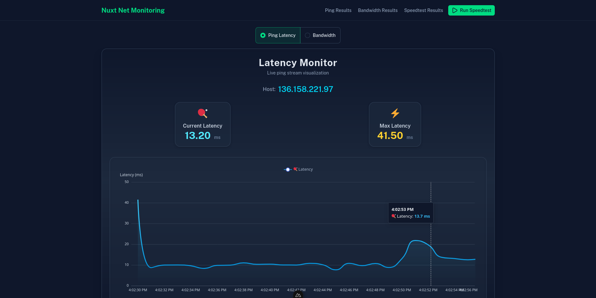
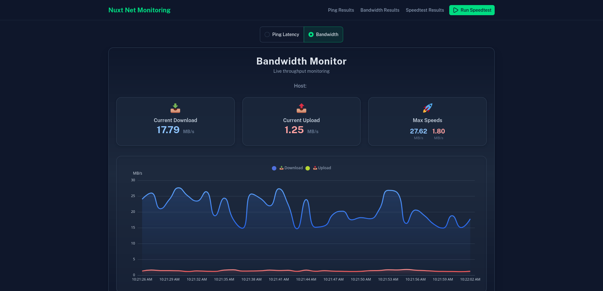
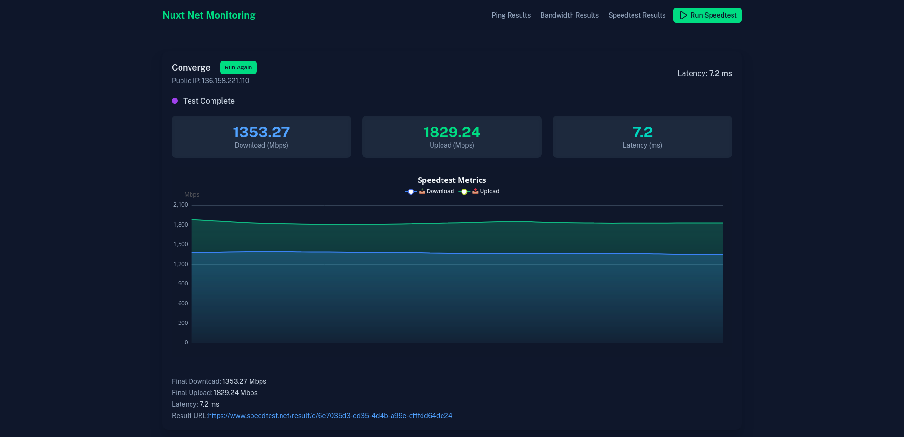

# Nuxt Network Monitoring System 🚀

[](https://nuxt.com/)
[](https://nodejs.org/)
[](https://www.pfsense.org/)
[](https://www.postgresql.org/)
[](https://www.speedtest.net/apps/cli)

A **real-time network monitoring system** built with Nuxt.js that continuously monitors network performance. Track ping latency, SNMP bandwidth from network devices (e.g., pfSense, OPNsense), and run internet speed tests with live visualizations and historical data storage.

## 📋 Table of Contents

- [Features](#-features)
- [Screenshots](#️-screenshots)
- [Quick Start](#-quick-start)
  - [Docker Deployment](#docker-deployment-recommended)
  - [Manual Installation](#manual-installation)
- [Usage](#-usage)
- [Configuration](#-configuration)
  - [SNMP Device and Interface Configuration](#snmp-device-and-interface-configuration)
  - [Multiple Ping Hosts](#multiple-ping-hosts)
- [Tech Stack](#️-tech-stack)
- [Architecture](#️-architecture)
  - [How It Works](#how-it-works)
  - [Database Schema](#database-schema)
- [Development](#️-development)
- [Troubleshooting](#️-troubleshooting)
- [Contributing](#-contributing)
- [License](#-license)

---

## 🎯 Features

### Real-Time Monitoring
* **Ping Monitoring**: Optional continuous ping monitoring with 1-second intervals. Configure hosts in the dashboard. Each host runs in its own process. Live data is streamed via SSE and 60-second averages are saved to the database
* **Bandwidth Monitoring**: Optional real-time SNMP monitoring of network interface traffic. Configure devices and interfaces in the dashboard. The app auto-discovers interface details, monitors 64-bit counters, and saves 60-second averages
* **Live Streaming**: Server-sent events (SSE) for real-time data updates without page refresh

### Speed Test Integration
* **Automated Testing**: Optional scheduled speed tests with configurable frequency (default: every hour when enabled)
* **Manual Testing**: On-demand speed tests with live progress visualization when the feature is enabled
* **Real-Time Results**: Live streaming of download/upload speeds during execution
* **Direct Integration**: Uses official Ookla Speedtest CLI with retry logic
* **Comprehensive Data**: Captures bandwidth, latency, ISP, public IP, and result URLs

### Data Visualization & History
* **Live Charts**: Real-time ECharts visualizations
* **Historical Data**: Browse and export historical data
* **Data Export**: CSV format downloads

### Security & Access
* **Admin Account**: First-run setup followed by username/password sign-in
* **Protected Routes**: Authenticated routes use secure, database-backed sessions
* **Dashboard Configuration**: Feature settings are saved in PostgreSQL and applied immediately

---

## 🖥️ Screenshots

**Dashboard Example**


**Live Bandwidth Chart**


**Speed Test Results**


---

## 🚀 Quick Start

### Docker Deployment (Recommended)

#### Prerequisites
- Docker and Docker Compose
- Network access required by the monitoring features you choose to enable

#### Steps

1. **Clone the Repository**
   ```bash
   git clone https://github.com/markchristianlacap/nuxt-net-monitoring.git
   cd nuxt-net-monitoring
   ```

2. **Configure Environment Variables**

   Create the environment file:
   ```bash
   cp .env.docker.example .env.docker
   ```

   Set your database values in `.env.docker`:
   ```env
   NUXT_DB_PORT=5432
   NUXT_DB_USER=postgres
   NUXT_DB_PASSWORD=postgres
   NUXT_DB_NAME=net-monitor
   ```

   `NUXT_DB_HOST` is set to `postgres` by Docker Compose.

3. **Start the Application**
   ```bash
   docker compose up -d
   ```

   This builds the application, starts PostgreSQL, runs migrations, and starts on port 3000.

4. **Access the Application**

   Keep the app on a trusted network until setup is complete. Navigate to `http://localhost:3000/setup` to create the first administrator, then configure features from **Settings**. Settings are saved in PostgreSQL and apply immediately.

5. **View Logs** (optional)
   ```bash
   # View all logs
   docker compose logs -f

   # View app logs only
   docker compose logs -f app
   ```

6. **Stop the Application**
   ```bash
   docker compose down
   ```

   To remove all data including the database:
   ```bash
   docker compose down -v
   ```

---

### Manual Installation

For development or custom setups, you can install and run the application manually.

#### Prerequisites
1. Node.js (v18+), pnpm (v10.18.3+), PostgreSQL (v12+)
2. `ping`, SNMP access, and/or Ookla Speedtest CLI only for the features you enable

#### Steps

1. **Clone the Repository**
   ```bash
   git clone https://github.com/markchristianlacap/nuxt-net-monitoring.git
   cd nuxt-net-monitoring
   ```

2. **Install Dependencies**
   ```bash
   pnpm install
   ```

3. **Configure Environment Variables**

   Create the environment file:
   ```bash
   cp .env.example .env
   ```

   Set your database values:
   ```env
   NUXT_DB_HOST=localhost
   NUXT_DB_PORT=5432
   NUXT_DB_USER=postgres
   NUXT_DB_PASSWORD=your-db-password
   NUXT_DB_NAME=net-monitor
   ```

4. **Setup Database**

   Create the PostgreSQL database:
   ```bash
   psql -U postgres -c "CREATE DATABASE \"net-monitor\";"
   ```

   Run migrations:
   ```bash
   pnpm run db:migrate
   ```

5. **Run the Application**

   Development mode:
   ```bash
   pnpm run dev
   ```

   Production mode:
   ```bash
   pnpm run build
   node .output/server/index.mjs
   ```

The application will be available at `http://localhost:3000`

---

## 📝 Usage

### Authentication

On first launch, visit `/setup` to create the first administrator account. This route closes once the account is created. Keep the application private or on a trusted network until setup is complete. The password is stored as a hash in PostgreSQL; subsequent access uses `/login`.

### Main Dashboard (`/`)

The homepage displays real-time monitoring with two tabs:

1. **Ping Latency Tab**
   - Live streaming ping data every second
   - Monitor multiple hosts with color-coded visualization
   - Real-time latency graphs and status indicators per host
   - Summary statistics: total/online/offline hosts, average/peak latency
   - 60-second averages stored in database

2. **Bandwidth Tab**
   - Live SNMP bandwidth monitoring every second
   - Monitor multiple interfaces with color-coded visualization
   - Individual interface metrics: upload/download speeds in Mbps
   - 60-second averages stored in database

### Speed Test (`/speedtest`)

- Live progress with real-time metrics
- Download/upload speed visualization
- Ping latency measurement
- ISP and public IP detection
- Results saved automatically
- Sharable result URL

### Historical Data

1. **Ping Results** (`/pings`) - Historical ping data with CSV export
2. **Bandwidth Results** (`/bandwidths`) - Historical bandwidth measurements with CSV export
3. **Speed Test Results** (`/speedtest-results`) - Past speed test history with CSV export

---

## 🔧 Configuration

### SNMP Device and Interface Configuration

**Compatible with pfSense and OPNsense firewalls** - both use standard SNMP v2c protocol.

Configure monitoring from **Settings** in the dashboard. Enable bandwidth monitoring, add one or more SNMP devices, and provide each device's host and community string. Display names are optional; when omitted, the device host is used. Leave the interface list blank to monitor all interfaces, or provide comma-separated interface names to filter them. Settings are stored in PostgreSQL and take effect without restarting the app.

**SNMP OIDs Used:**
- Interface Index: `1.3.6.1.2.1.2.2.1.1`
- Interface Name: `1.3.6.1.2.1.31.1.1.1.1`
- Interface Description: `1.3.6.1.2.1.2.2.1.2`
- Interface Status: `1.3.6.1.2.1.2.2.1.8`
- Interface Speed: `1.3.6.1.2.1.31.1.1.1.15`
- 64-bit In Octets: `1.3.6.1.2.1.31.1.1.1.6`
- 64-bit Out Octets: `1.3.6.1.2.1.31.1.1.1.10`
- IP Address Mapping: `1.3.6.1.2.1.4.20.1.2`

**Interface Discovery Process:**
1. Walks SNMP tree to discover all interfaces
2. Retrieves interface details
3. Maps IP addresses to interface indices
4. Filters by configured interface names
5. Caches results for 30 seconds

**Finding Your Interface Names:**

```bash
snmpwalk -v2c -c your-community-string your-host-ip 1.3.6.1.2.1.31.1.1.1.1
```

**Interface Selection:**
- Specify interface names in each `snmp.devices[].interfaces` array to monitor specific interfaces on that device
- Common names: `eth0`, `eth1`, `em0`, `igb0`, `lan`, `wan`

The application automatically handles 64-bit counter values, converts to Mbps, maintains separate tracking per device/interface pair, and provides color-coded visualization. Interfaces with the same name on different devices remain distinct.

### Multiple Ping Hosts

Enable ping monitoring in **Settings** and enter one hostname or IP address per line.

Features: Independent monitoring per host, color-coded visualization, individual statistics, overall summary with total/online/offline hosts.

### Speed Test Frequency

Enable scheduled speed tests in **Settings**, choose to run them every 1 hour, 3 hours, 12 hours, or 7 days, or enter a custom frequency from 1 hour to 7 days. Optionally select the local interface used by scheduled runs. The live test page also lets you select an interface for each run. Available interfaces are those visible to the app process; in Docker, this usually means the container's interfaces, not every host adapter.

**Schedule Frequency Values:**
- `3600` = 1 hour (default)
- `10800` = 3 hours
- `43200` = 12 hours
- `604800` = 7 days

The speed test will automatically run at the specified interval. You can still trigger manual speed tests at any time via the web interface.

---

## ⚙️ Tech Stack

### Frontend
* **Framework**: Nuxt 4.x (Vue 3)
* **UI Library**: Nuxt UI (TailwindCSS-based)
* **Charts**: nuxt-echarts with Apache ECharts

### Backend
* **Runtime**: Nuxt Nitro server (Node.js)
* **Database**: PostgreSQL with Drizzle ORM
* **SNMP Library**: net-snmp for device communication
* **Protocols**: ICMP Ping, SNMP v2c, session-based admin authentication

### External Dependencies
* **Speedtest CLI**: Ookla Speedtest CLI with retry logic
* **SNMP**: SNMP-enabled network device (e.g., pfSense, OPNsense router)
* **System Commands**: Native `ping` command
---

## 🏗️ Architecture

### How It Works

#### Background Processes

The application has three optional background monitoring processes via Nitro plugins. Each starts only when enabled in dashboard settings:

1. **Ping Monitor** (`server/plugins/ping.server.ts`)
   - Spawns independent `ping` processes for each configured host when ping monitoring is enabled
   - Loads hosts from PostgreSQL settings and applies dashboard changes while running
   - Each host runs in its own child process with separate stdout monitoring
   - Parses latency from ping output using regex pattern matching (`time=([\d.]+) ms`)
   - Streams real-time data via events system and SSE to frontend
   - Collects latency readings in memory arrays per host
   - Calculates and stores 60-second averages in PostgreSQL `pings` table
   - Handles ping process errors and restart logic

2. **Bandwidth Monitor** (`server/plugins/bandwidth.server.ts`)
   - Uses precise timing helper (`runEverySecond`) for consistent 1-second intervals
   - Auto-discovers and caches interface information for 30 seconds
   - Monitors interfaces configured for each enabled SNMP device in PostgreSQL settings
   - Queries each SNMP device using an independent net-snmp session
   - Reads 64-bit interface counters (ifHCIn/ifHCOut) via SNMP OIDs
   - Calculates bandwidth delta between readings (handles counter wraparound)
   - Converts bytes to Mbps: `(bytes * 8) / (timeDiff * 1,000,000)`
   - Streams real-time bandwidth data via events to frontend
   - Stores 60-second averages in `bandwidths` table with host, display name, and interface identification

3. **Speed Test Scheduler** (`server/plugins/speedtest.server.ts`)
   - Runs Ookla Speedtest CLI at configurable intervals using `runEveryInterval` timing helper
   - Runs only when enabled; frequency is loaded from PostgreSQL settings (default: 3600 seconds/1 hour)
   - Executes `speedtest -f jsonl --accept-license` command
   - Implements retry logic with exponential backoff (3 attempts, 1s base delay)
   - Parses JSONL output to extract final result object
   - Stores comprehensive results in `speedtest_results` table
   - Captures: download/upload bandwidth, latency, ISP, public IP, result URL

#### Real-Time Streaming

- **Server-Sent Events (SSE)**: Efficient live data streaming using Nuxt's event system
- **Event-driven Architecture**: Background processes emit events via global events emitter
- **Stream Endpoints**:
  - `/api/pings/stream` - Live ping data stream for all monitored hosts (1-second updates)
  - `/api/bandwidths/stream` - Live bandwidth stream for all monitored interfaces (1-second updates)
  - `/api/speedtest` (POST) - Live speed test execution with JSONL streaming and progress updates
- **Interface Discovery**: `/api/interfaces` - Returns available SNMP interfaces with auto-discovery
- **Connection Management**: Automatic cleanup on client disconnect and error handling

#### Data Collection & Storage Strategy

The application uses a two-tier approach for optimal performance:

**Real-Time Collection** (Every 1 second):
- Ping latency measurements for each configured host
- SNMP bandwidth readings for each configured interface
- Streamed to frontend via SSE for live visualization with real-time updates

**Database Storage** (Every 60 seconds):
- Averaged ping latency over the past minute per host
- Averaged bandwidth readings over the past minute per interface
- Reduces database writes while maintaining data accuracy
- Historical data remains accessible for analysis and export
- Each host's and interface's data is stored separately for independent tracking

This approach provides real-time monitoring responsiveness while efficiently managing database resources.

### Database Schema

All data is stored in PostgreSQL using Drizzle ORM:

- **pings**: `id`, `host`, `status`, `latency`, `timestamp`
- **bandwidths**: `id`, `host`, `displayName`, `interface`, `inMbps`, `outMbps`, `timestamp`
- **speedtest_results**: `id`, `download`, `upload`, `latency`, `isp`, `ip`, `url`, `timestamp`

---

## 🛠️ Development

### Available Scripts

```bash
# Start development server with hot reload
pnpm run dev

# Build for production
pnpm run build

# Preview production build
pnpm run preview

# Type checking
pnpm run typecheck

# Lint code
pnpm run lint

# Generate a migration after changing the Drizzle schema
pnpm run db:generate

# Apply pending database migrations
pnpm run db:migrate
```

### Docker Development

For Docker-based development:

```bash
# Rebuild and restart containers after code changes
docker compose up -d --build

# View real-time logs
docker compose logs -f app

# Execute commands inside the container
docker compose exec app pnpm run typecheck
docker compose exec app pnpm run lint

# Access the PostgreSQL database
docker compose exec postgres psql -U postgres -d net-monitor

# Restart just the app container
docker compose restart app
```

### Project Structure

```
nuxt-net-monitoring/
├── app/
│   ├── pages/              # Vue pages (routes)
│   ├── components/         # Vue components
│   ├── assets/            # CSS and static assets
│   └── app.vue            # Root component with navigation
├── server/
│   ├── api/               # API endpoints with SSE streaming
│   ├── db/                # Drizzle schema, client, and migrations
│   ├── middleware/        # Server middleware (session authentication and feature gates)
│   ├── plugins/           # Background processes (ping, bandwidth, speedtest)
│   └── utils/             # Utility functions (timing, SNMP, CSV export)
├── shared/                # Shared types and utilities between client/server
│   ├── types/             # TypeScript interfaces and types
│   └── utils/             # Shared utility functions
├── nuxt.config.ts         # Nuxt configuration
├── drizzle.config.ts      # Database migration configuration
├── docker-compose.yml     # Docker deployment configuration
└── .env                   # Environment variables
```

---

## ⚠️ Troubleshooting

### Docker Issues

**Container fails to start**
```bash
docker compose logs app
sudo netstat -tlnp | grep 3000  # Check port usage
docker compose up -d --build    # Rebuild
```

**Database connection issues**
```bash
docker compose ps              # Check health
docker compose logs postgres   # Check logs
docker compose restart postgres
```

**Changes not reflecting**
```bash
docker compose up -d --build app
```

### General Issues

**Speedtest CLI Not Found**
```bash
curl -s https://packagecloud.io/install/repositories/ookla/speedtest-cli/script.deb.sh | sudo bash
sudo apt-get install speedtest
```

**SNMP Connection Issues**
- Verify SNMP is enabled on your device
- Check community string is correct
- Ensure firewall allows SNMP (UDP port 161)
- Test with: `snmpwalk -v2c -c your-community device-ip system`

**Database Connection Failed**
- Verify PostgreSQL is running and credentials are correct
- Ensure database exists: `psql -U postgres -l`
- Run migrations: `pnpm run db:migrate`

**Ping Not Working**
- Check target host is reachable and `ping` command is available
- Some systems require elevated privileges for ICMP

---

## 🤝 Contributing

Contributions are welcome! Please feel free to submit a Pull Request.

---

## 📄 License

This project is open source and available under the MIT License.

---

## 📧 Contact

For questions or support, please open an issue on GitHub.
